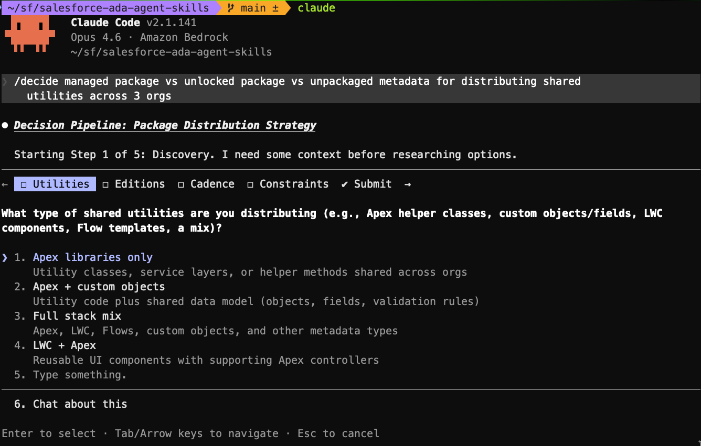

<div align="center">
	
	<h1>Salesforce Ada Agent Skills</h1>
</div>

<h4 align="center">
	<a href="#overview">Overview</a> |
	<a href="#setup">Setup</a> |
	<a href="#how-it-works">How it Works</a> |
	<a href="#faqs">FAQs</a> |
	<a href="#contributing">Contribute</a>
</h4>
	
<h3 align="center">
	An agent skill repository to help with guided learning and technical decisions<br><br>
</h3>

<div align="center">
	
</div>

<br>

## Overview

> **Disclaimer:** This is a community project and not an official Salesforce product. It is not supported, endorsed, or maintained by Salesforce.

A Salesforce skills repository for AI coding agents focused on **learning** and **decision-making** — not writing code. Clone the repo, launch your preferred agent, and it walks you through a structured workflow grounded in official Salesforce documentation.

Supports **Claude Code**, **Gemini CLI**, and **Codex CLI**.

> Looking for coding skills (Apex, LWC, Flows, Agentforce)? See the [Agentforce Vibes skill repo](https://github.com/deejay-hub/agentforce-vibes).

| Command | Purpose |
|---------|---------|
| `/learn` | Educate on Salesforce Admin, Developer and Architecture topics with citation-grounded responses |
| `/decide` | Structured decision pipeline: discovery, options, criteria, risk scoring, decision record |

## Setup

1. Clone this repository:
   ```bash
   git clone https://github.com/deejay-hub/salesforce-ada-agent-skills.git
   cd salesforce-ada-agent-skills
   ```

2. Launch your preferred agent:

   | Agent | Command | Instructions file |
   |-------|---------|-------------------|
   | Claude Code | `claude` | `CLAUDE.md` |
   | Gemini CLI | `gemini` | `GEMINI.md` |
   | Codex CLI | `codex` | `AGENTS.md` |

3. Type `/decide` or `/learn` followed by your topic — you're ready to go.

   > In Codex CLI (which has no slash commands), type `decide: [topic]` or `learn: [topic]` instead.

#### Optional: Connect a documentation MCP server

The skills work without MCP (using the agent's training knowledge and web search), but connecting a documentation MCP server adds real-time documentation search and citations.

The repo includes an example configuration with two MCP servers. The skills prefer `salesforce-content` when available and fall back to Context7 or other documentation MCP tools:

- **[salesforce-content](https://github.com/deejay-hub/salesforce-ada-content-mcp-server)** — A purpose-built Salesforce documentation MCP server. See the [setup instructions](https://github.com/deejay-hub/salesforce-ada-content-mcp-server) to run it locally.
- **Context7** — A general-purpose library documentation MCP (no setup required beyond `npx`).

1. Create your MCP config:
   ```bash
   cp .mcp.json.example .mcp.json
   ```

2. Verify connectivity:
   - **Claude Code** — type `/mcp` in the session and confirm the server connects
   - **Gemini CLI** — the MCP server is auto-discovered from `.mcp.json`
   - **Codex CLI** — the MCP server is auto-discovered from `.mcp.json`

## How it Works

### The Decision Pipeline (`/decide`)

Type `/decide` followed by your question and the agent runs a 5-step pipeline, pausing for your confirmation between each step:

1. **Discovery** — gathers context about your problem, scale, and constraints
2. **Solution Options** — proposes 3-4 options backed by official documentation
3. **Assessment Criteria** — generates criteria that define what "better" means for this decision
4. **Risk Assessment** — differentiating questions, then rates each option against each criterion (Low/Med/High) with cited rationale
5. **Decision Score** — weighted sum across Well-Architected pillars, outputs a decision record to disk

At every gate you can add, remove, or modify options and criteria. The pipeline prevents a flawed assumption from propagating unchallenged to the recommendation.

Example prompts:

```
/decide single org vs multi-org for a global enterprise with regional autonomy needs
/decide CDC vs Platform Events vs Apex REST for integrating with an Oracle ERP
/decide Flow vs Apex trigger for high-volume lead assignment
```

### The Learn Pipeline (`/learn`)

Type `/learn` followed by your topic and the agent researches official Salesforce documentation, blogs, and video transcripts to give you a grounded answer:

1. **Discovery** — clarifies what you want to understand and your experience level
2. **Research** — searches docs, blogs, videos, and code samples via documentation tools
3. **Synthesize** — presents a structured response with definitions, how it works, constraints, and practical guidance — every claim cited
4. **Follow-up** — offers to go deeper, show examples, or compare alternatives

Example prompts:

```
/learn what is the difference between CDC and Platform Events
/learn how does Data 360 handle identity resolution
/learn what are the governor limits for Batch Apex
/learn what's new in the Summer '25 release for developers
```


### Project Structure

The repo has four layers:

```
salesforce-ada-agent-skills/
├── CLAUDE.md                    # Claude Code system prompt
├── GEMINI.md                    # Gemini CLI system prompt
├── AGENTS.md                    # Codex CLI system prompt
├── .mcp.json                    # MCP server config (gitignored)
├── .claude/
│   └── skills/                  # Claude Code slash commands
│       ├── learn/SKILL.md
│       └── decide/SKILL.md
├── .gemini/
│   └── skills/                  # Gemini CLI skills
│       ├── learn/SKILL.md
│       └── decide/SKILL.md
├── knowledge/
│   ├── formats/                 # Shared output templates (all agents reference these)
│   │   ├── options-format.md
│   │   ├── criteria-format.md
│   │   ├── risk-matrix-format.md
│   │   └── decision-format-*.md
│   ├── scoring/                 # Decision score methodology
│   └── modifiers/               # Pillar lenses (trust, reliability, ops, resource, cost, fairness) + concise format modifier
└── output/
    └── decisions/               # Generated decision records
```

**System prompt files** (`CLAUDE.md`, `GEMINI.md`, `AGENTS.md`) set global behavior. Each agent auto-loads its own.

**SKILL.md files** are the orchestrators — they define what happens, in what order, with what tools. They load when you invoke the skill. For Codex (no skill system), the workflows are inlined into `AGENTS.md`.

**Format files** (`knowledge/formats/`) are shared templates that produce consistent output regardless of which agent or model runs the pipeline.

**Knowledge files** are deferred reference material — scoring rubrics and modifier lenses that load only when needed.

## FAQs

#### Why not just use plan mode in Agents directly?

Instead of hoping the agent asks the right questions and considers the right trade-offs, every decision follows a repeatable, evidence-grounded workflow with confirmation gates that prevent flawed assumptions from propagating unchallenged. Scoring eliminates narrative bias -- plan mode lets the agent recommend whatever "feels right" in prose, while this repo forces a quantified risk matrix where the numbers decide, ensuring the recommendation is always traceable back to documented platform facts.

#### Why a CLI agent instead of a web app?

No infrastructure to maintain, no hosting costs, no auth to manage. The entire tool is a directory of markdown files — version-controlled, forkable, and extensible. Updates are a `git pull`.

#### Can I use this without the MCP server?

Yes. Without MCP, the tool falls back to web search for grounding in official Salesforce documentation. If web search is also unavailable, it uses the agent's training knowledge and the local knowledge files. The structured pipelines, scoring, and output formats all still work regardless. The tool will clearly state which grounding method it's using.

#### Can multiple people use this on the same repo?

Yes. Decision records in `output/` can be committed and shared — they're designed as durable team artifacts.

## Contributing

Contributions are greatly appreciated. See [CONTRIBUTING.md](CONTRIBUTING.md) for guidelines.

## License

MIT
